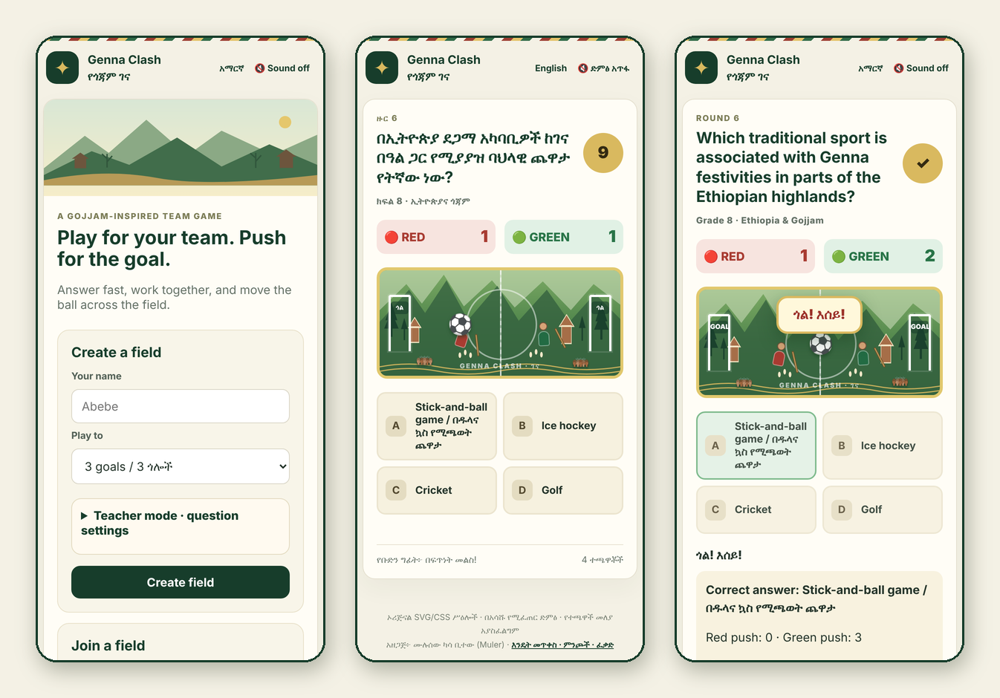
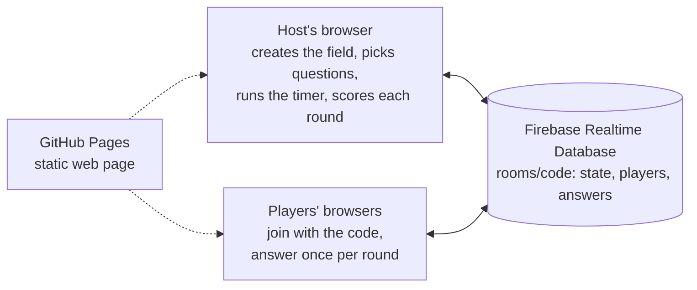

<div align="center">

# Genna Clash · የጎጃም ገና

### A bilingual multiplayer team quiz inspired by Genna, the Ethiopian Christmas game

Two teams, one ball, fifteen seconds. Answer fast and right, and your team pushes the ball towards the other goal,
as in Genna, the stick-and-ball game played in the Ethiopian highlands at Christmas.

[](https://muler-21.github.io/genna-clash/)

[](#how-to-play)
[](#features)
[](#question-bank)
[](#how-to-cite)
[](#licence)
[](https://orcid.org/0000-0001-6223-0037)



**Created by [Mulusew Kassa Bitew (Muler)](https://orcid.org/0000-0001-6223-0037)** ·
[How to play](#how-to-play) · [How to cite](#how-to-cite) · [Sources](#sources) · [Licence](#licence)

</div>

---

## About

Genna Clash turns a classroom or family quiz into a team match. One person creates a **field** and shares its
four-letter code; everyone else joins on their own phone or computer and picks the Red or Green team. Every round,
all players see the same question in English or Amharic. Quick correct answers move the ball across a field set in
the hills of Gojjam, and a goal earns a cheer: *ጎል! እሰይ!*

It was created for the Handshake AI Skills Studio × OpenAI *Create a Multiplayer Game* challenge (October 2026)
and is free to play, with no accounts and no installation.

## How to play

1. **Join teams.** The host creates a field and shares the code; players join and choose Red or Green.
2. **Answer quickly.** Each round has one question with four answers and a 15-second timer. Everyone answers once.
3. **Push the ball.** A team with at least one correct answer earns one push point per correct player, plus one.
   The ball moves towards the goal of the team with fewer points, by the difference (at most 3 steps per round).
4. **Score.** When the ball travels 5 steps from the centre, it is a goal and the ball returns to the centre.
   The first team to the target (1, 3 or 5 goals) wins; the match also ends if the questions run out.

At full time, the results show the final score and the **star player**: the player who was most often the first
correct answer in their team.

**Teacher mode.** Before starting, the host chooses a school grade (3–8; questions at or below that grade are used)
and one or more categories. Questions never repeat within a match.

## Features

- **Real-time multiplayer** for 2 to 100 players, on any device with a browser.
- **Bilingual**: every question, answer and screen in English and Amharic, switchable at any time.
- **Built for classrooms**: grade and category filters, large touch targets, short 15-second rounds.
- **No accounts, no installation**: players type a display name (up to 12 characters); sign-in is anonymous.
- **Robust**: players can refresh or reconnect; if the host drops out, another player takes over automatically.
- **Original artwork and sound**: the Gojjam landscape, field and players are drawn in SVG/CSS, and the sounds are
  generated in the browser, so there are no image or audio files to download.
- **Accessible**: works on small phones, respects the system's reduced-motion setting, and sound can be muted.

## Question bank

120 questions, each in English and Amharic, written for primary and middle school (grades 3–8).

| Category | Questions | Examples |
|---|---:|---|
| Math · ሒሳብ | 30 | times tables, fractions, percentages, simple equations, probability |
| Science · ሳይንስ | 30 | states of matter, plants, the human body, the solar system, forces |
| Amharic words · የአማርኛ ቃላት | 30 | everyday vocabulary, opposites, plurals, greetings, Ethiopic punctuation |
| Ethiopia & Gojjam · ኢትዮጵያና ጎጃም | 30 | Genna and Meskel, Lake Tana and the Blue Nile, the Choke Mountains, Lalibela |

All questions were reviewed in November 2026, and 31 were corrected in version 1.1.0. Every fact in the
*Ethiopia & Gojjam* category is checked against a published source ([below](#sources)). Questions are stored in
[`questions.js`](questions.js), one object per question (`id`, category `c`, grade, `en`, `am`, options `o`,
answer index `a`), so teachers can add their own.

## How it works



The page is plain HTML, CSS and JavaScript with no build step. Firebase Anonymous Authentication gives every
player an ID without an account, and the Realtime Database keeps all screens in sync. The host's browser
coordinates each round using Firebase's server-time offset. [`database.rules.json`](database.rules.json) allows
only the host to change the match state (another connected player can take over if the host disconnects), lets
each player write only their own record and a single answer per round before the timer ends, and validates names,
teams and match settings.

## Background: Genna

Genna (ገና) is the Ethiopian Orthodox celebration of Christmas, also called Lidet (ልደት, "birth"). It falls on
7 January, which is Tahsas 29 in the Ethiopian calendar ([Wikipedia: Ethiopian Christmas](https://en.wikipedia.org/wiki/Ethiopian_Christmas)).

The holiday gives its name to *ye-Genna chewata* (የገና ጨዋታ), a traditional game similar to field hockey. Players
strike a hard wooden ball, the *rur*, with wooden sticks; old men from the crowd act as referees, and play can last
until sunset. Tradition says it began with shepherds who, hearing of the birth of Jesus, celebrated by striking
things around them with their sticks. The game is fading in cities but is still played in rural areas
([Hailu, ENA](https://www.ena.et/en/?p=5346); [Konrad-Adenauer-Stiftung](https://www.kas.de/en/web/aethiopien/static-contents-detail/-/content/ye-gena-chewata-1)).

Genna Clash is set in Gojjam, the historic province in north-western Amhara Region, home of the Choke Mountains in
the Blue Nile (Abay) highlands. It is a playful digital tribute to the spirit of the game (teamwork, speed and
celebration) and does not try to reproduce its rules.

## How to cite

If you use Genna Clash or its question bank in teaching, research, an event or another project, please cite it:

> Bitew, M. K. (2026). *Genna Clash: A bilingual multiplayer team quiz inspired by Genna, the Ethiopian Christmas
> game* (Version 1.1.0) [Computer software]. https://github.com/Muler-21/genna-clash

```bibtex
@software{bitew_2026_genna_clash,
  author  = {Bitew, Mulusew Kassa},
  title   = {Genna Clash: A Bilingual Multiplayer Team Quiz Inspired by Genna,
             the Ethiopian Christmas Game},
  year    = {2026},
  version = {1.1.0},
  url     = {https://github.com/Muler-21/genna-clash},
  note    = {Playable at https://muler-21.github.io/genna-clash/}
}
```

GitHub's **Cite this repository** button (right-hand sidebar) gives the same citation in APA and BibTeX, generated
from [`CITATION.cff`](CITATION.cff).

## Sources

The *Ethiopia & Gojjam* questions and the background text above were checked against these sources (November 2026).
Math, science and Amharic-vocabulary questions cover standard school content and were checked by hand.

| Topic | Questions (`ethiopia-…`) | Source |
|---|---|---|
| Genna: date, names and the stick-and-ball game | 05, 24, 28 | Wikipedia (Ethiopian Christmas); Hailu (ENA); Konrad-Adenauer-Stiftung |
| Ethiopian calendar: 13 months; New Year in Meskerem | 10, 18 | Embassy of Ethiopia, London |
| Lake Tana, the Blue Nile (Abay) and Bahir Dar | 02, 06, 16, 20, 26 | Britannica (Lake Tana) |
| Bahir Dar, capital of the Amhara Region | 09 | City Administration of Bahir Dar |
| Gojjam in the Amhara Region | 03, 27 | Wikipedia (Gojjam) |
| Choke Mountains | 04, 29 | Simane et al. (2013); The Niles |
| Addis Ababa as capital; Amharic as federal working language | 01, 17 | Constitution of Ethiopia, Articles 49 and 5 |
| National flag | 07 | Britannica (Flag of Ethiopia) |
| Teff and injera | 08, 15, 23 | Britannica (Teff) |
| Jebena and the coffee ceremony | 11 | Wikipedia (Jebena) |
| Coffee exports | 30 | Food Business MEA (2025) |
| Lalibela; the castles of Gondar | 12, 25 | UNESCO World Heritage List |
| Meskel | 22 | UNESCO Intangible Cultural Heritage (2013) |
| Abebe Bikila | 13 | Olympics.com |
| Walia ibex | 14 | Scholte et al. (2025) |
| Tibeb, the woven border | 19 | Wikipedia (Habesha kemis) |
| Kiremt, the main rainy season | 21 | Ethiopian Meteorological Institute (2024) |

### References

- Britannica. (n.d.). *Flag of Ethiopia*. https://www.britannica.com/topic/flag-of-Ethiopia
- Britannica. (n.d.). *Lake Tana*. https://www.britannica.com/place/Lake-Tana
- Britannica. (n.d.). *Teff*. https://www.britannica.com/plant/teff
- City Administration of Bahir Dar. (n.d.). *History*. https://bahirdar.gov.et/en/city/history
- Embassy of the Federal Democratic Republic of Ethiopia, London. (n.d.). *Calendar*.
  https://mail.ethioembassy.org.uk/about_us/calendar.htm
- Ethiopian Meteorological Institute. (2024). *Seasonal climate bulletin for Kiremt 2024*.
  https://www.ethiomet.gov.et/documents/321/kiremt_2024_seasonal_climate_bulletin.pdf
- Federal Democratic Republic of Ethiopia. (1995). *Proclamation No. 1/1995: Proclamation of the Constitution of the
  Federal Democratic Republic of Ethiopia*. Federal Negarit Gazeta. https://humanrts.umn.edu/research/Proclamation%20no.1-1995.pdf
- Food Business MEA. (2025, July 10). *Ethiopia's coffee exports hit record US$2.65B in 2024/25 fiscal year*.
  https://www.foodbusinessmea.com/ethiopias-coffee-exports-hit-record-us2-65b-in-2024-25-fiscal-year/
- Hailu, F. (n.d.). *Unique features of Ethiopian Christmas "Genna"*. Ethiopian News Agency.
  https://www.ena.et/en/?p=5346
- International Olympic Committee. (n.d.). *Barefooted Bikila steps in for heroic marathon triumph*. Olympics.com.
  https://olympics.com/en/news/barefooted-bikila-steps-in-for-heroic-marathon-triumph
- Konrad-Adenauer-Stiftung, Foundation Office Ethiopia. (2023, January 7). *Ye'gena Chewata* [KAS African History
  Calendar]. https://www.kas.de/en/web/aethiopien/static-contents-detail/-/content/ye-gena-chewata-1
- Scholte, P., Abebe, B., Seraw, E., Abedela, F., Kinfe, M., May, B., Mekuria, W., Pays, O., Regassa, F., Simegn, T.,
  Solomon, S., Teklu, T., Wonde, E., & Wakjira, K. (2025). Severe decline of the only remaining population of walia
  ibex in Ethiopia: Proposed actions and recommended recategorization as Critically Endangered. *Oryx*.
  https://doi.org/10.1017/S0030605325000341
- Simane, B., Zaitchik, B. F., & Ozdogan, M. (2013). Agroecosystem analysis of the Choke Mountain watersheds,
  Ethiopia. *Sustainability, 5*(2), 592–616. https://doi.org/10.3390/su5020592
- The Niles. (n.d.). *Choke Mountain sediments stifle downstream reservoirs*.
  https://www.theniles.org/en/articles/economy/20785/Choke-Mountain-sediments-stifle-downstream-reservoirs.htm
- UNESCO. (2013). *Commemoration feast of the finding of the True Holy Cross of Christ* [Representative List of the
  Intangible Cultural Heritage of Humanity].
  https://ich.unesco.org/en/RL/commemoration-feast-of-the-finding-of-the-true-holy-cross-of-christ-00858
- UNESCO World Heritage Centre. (n.d.). *Fasil Ghebbi, Gondar Region*. https://whc.unesco.org/en/list/19
- UNESCO World Heritage Centre. (n.d.). *Rock-hewn churches, Lalibela*. https://whc.unesco.org/en/list/18
- Wikipedia contributors. (n.d.). *Ethiopian Christmas*. https://en.wikipedia.org/wiki/Ethiopian_Christmas
- Wikipedia contributors. (n.d.). *Gojjam*. https://en.wikipedia.org/wiki/Gojjam
- Wikipedia contributors. (n.d.). *Habesha kemis*. https://en.wikipedia.org/wiki/Habesha_kemis
- Wikipedia contributors. (n.d.). *Jebena*. https://en.wikipedia.org/wiki/Jebena

## Run your own copy

1. **Fork** this repository.
2. In the [Firebase console](https://console.firebase.google.com), create a project, then:
   - **Authentication → Sign-in method:** enable **Anonymous**.
   - **Realtime Database:** create a database, then paste [`database.rules.json`](database.rules.json) into its
     **Rules** tab and publish.
   - **Project settings → Your apps:** add a web app and copy its settings into `firebase-config.js`
     (start from [`firebase-config.example.js`](firebase-config.example.js)). These values are public identifiers,
     not secrets.
3. On GitHub: **Settings → Pages → Deploy from a branch → `main` / root**. The game appears at
   `https://<your-username>.github.io/genna-clash/`.

Firebase's free Spark plan is enough for classroom use: it allows up to 100 simultaneous connections
([Firebase limits](https://firebase.google.com/docs/database/usage/limits)).

## Fair play and privacy

- Players need no account. The game stores only each player's display name, team, answers and scores in the match.
- Page views are counted anonymously, without cookies ([GoatCounter](https://www.goatcounter.com)).
- This is a casual educational game. Because it runs entirely in the browser, a technically skilled player could
  look up the answers in the page code, so it is not meant for high-stakes competitions.

## Repository structure

```
index.html                  page structure: home, lobby, game, results, How to play, About Genna
app.js                      game logic: fields, teams, rounds, scoring, host handoff, sound, language switch
questions.js                120 bilingual questions
style.css                   layout, the SVG/CSS artwork styles, mobile and reduced-motion support
database.rules.json         Firebase security rules
firebase-config.js          public Firebase settings of the live game
firebase-config.example.js  template for your own copy
docs/img/                   README images
```

## Licence

Genna Clash is free for any **non-commercial** use, including classrooms, schools, clubs, community events and
research, as long as you **credit the author**.

| What | Licence |
|---|---|
| Source code | [PolyForm Noncommercial 1.0.0](LICENSE). Copies must keep the `Required Notice` lines, which include the citation. |
| Questions, translations, game texts and original artwork | [CC BY-NC 4.0](LICENSE-CONTENT.md) |

For **commercial licensing**, contact the author through [GitHub](https://github.com/Muler-21).

## Author

**Mulusew Kassa Bitew (Muler)** · ORCID [0000-0001-6223-0037](https://orcid.org/0000-0001-6223-0037) ·
GitHub [Muler-21](https://github.com/Muler-21) · Also by the author:
[Sebel Hakim](https://github.com/Muler-21/sebel-hakim), free offline crop-disease diagnosis.

© 2026 Mulusew Kassa Bitew. See [Licence](#licence).
